# 🖨️ CUPS Web — 网页打印管理

<div align="center">


[GitHub](https://github.com/Mars666613/cups-web) · [Docker Hub](https://hub.docker.com/r/mars666613/cups-web) · [开发文档](AGENTS.md) · [深度文档](docs/README.md)

</div>

> ### 关于本分支
>
> 本项目基于 **[hanxi/cups-web](https://github.com/hanxi/cups-web)** 二次开发。原项目由 [涵曦](https://github.com/hanxi) 创作，采用 MIT 许可证 —— 感谢原作者。
>
> 原项目面向「家用 / 小型办公室，把一台 USB 打印机变成网络打印服务」。本分支在它之上做了较大改造，把它扩展成**可以对外运营的打印服务**，同时支持两种彼此独立的部署形态：
>
> | 部署形态 | 谁在用 | 一句话流程 |
> | --- | --- | --- |
> | 🏪 **自助打印门店** | 便利店 / 超市 / 校园里的顾客 | 扫打印机上的码 → 上传文件 → 支付宝付款 → **立刻出纸** |
> | 🏢 **企业内网刷卡取件** | 企业 / 学校内部的员工 | 电脑上提交任务（**先暂存，不出纸**）→ 走到打印机刷工牌 → **才出纸** |
>
> 两者由管理端开关**二选一**（另有一个「访客免登录」模式，同样与它们互斥）。差别不只是收不收钱，而是**打印从「提交时发生」变成了「刷卡时发生」**。
>
> 相对原项目的主要改动：
>
> - **数据层**：SQLite → **PostgreSQL**，多台终端 / 多实例共享一个中心库
> - **登录**：新增**支付宝授权登录** —— 扫码即登录，顾客不用注册、不用短信验证码
> - **计费与支付**：价目表与页数计价、余额账本（只增不改的流水）、充值与原路退款；支付宝手机网站支付 / 电脑网站支付，**无公网回调时靠主动查单结算**
> - **刷卡取件**：企业内网拉式打印，任务暂存在服务器，刷工牌后才释放到指定的那台打印机
> - **远程复印**：走 eSCL 扫描仪协议，手机上点一下就把原件扫进来打出去
> - **运维**：设备异常告警（缺纸 / 卡纸 / 门未开 / 耗材不足 / 设备不可达……）推送到企业微信、钉钉、飞书，以及管理员操作审计
> - **前端**：导航与信息架构重做，管理端拆成子页，手机与电脑共用一套界面
>
> 如果你要的是原项目那种「家用打印机共享」场景，直接前往 [hanxi/cups-web](https://github.com/hanxi/cups-web) 即可 —— 本项目的打印能力与驱动管理正是从那里来的。

基于 CUPS 的网页版打印管理工具：浏览器里上传文件、远程提交打印任务，支持多用户与打印记录追踪。除了家庭 / 小型办公室的基础共享打印，还内置了**计费支付**与**企业拉式打印（刷卡取件）**两种可运营形态 —— 前者可直接投放到自助打印门店，后者适合企业内部或学校机房。

## 📸 界面预览

打印侧是**手机优先**的（顾客扫码进来、员工走过去刷卡，都在手机上），管理端以桌面为主。界面自适应，两端共用同一套代码。

### 顾客 / 员工侧（手机）

<div align="center">
<table>
  <tr>
    <td align="center" width="25%">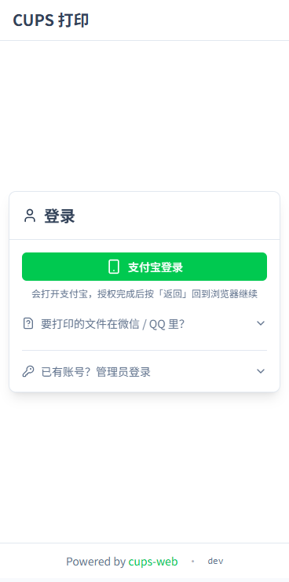<br/><b>登录</b><br/><sub>默认就是「支付宝登录」，密码登录收在下面</sub></td>
    <td align="center" width="25%">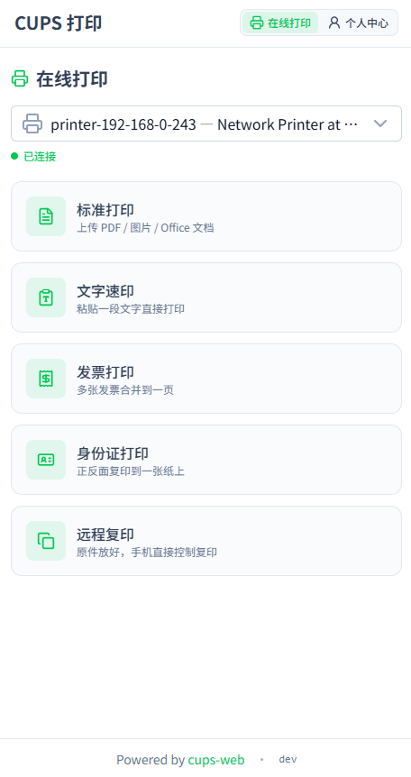<br/><b>在线打印（落地页）</b><br/><sub>选打印机 + 选模式，选完才展开参数</sub></td>
    <td align="center" width="25%">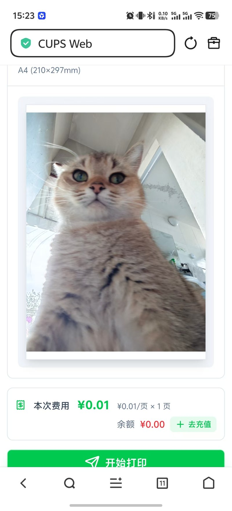<br/><b>实时预览</b><br/><sub>成品、页数、费用一次给全</sub></td>
    <td align="center" width="25%">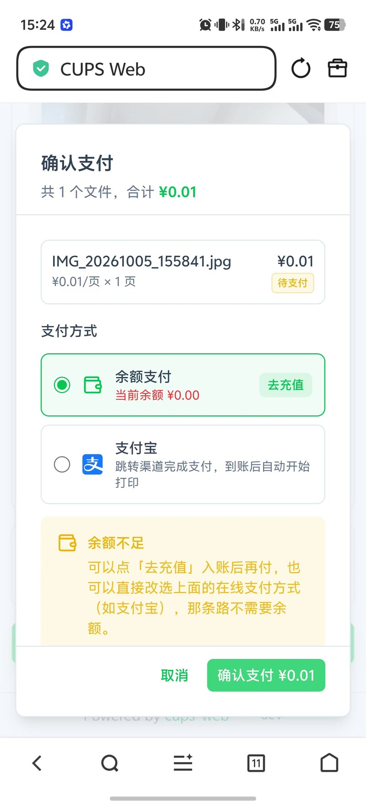<br/><b>确认支付</b><br/><sub>余额 / 支付宝两条路，余额不足会指出出路</sub></td>
  </tr>
  <tr>
    <td align="center" width="25%">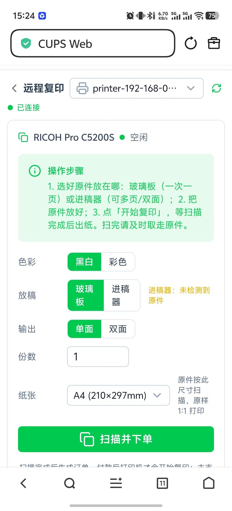<br/><b>远程复印</b><br/><sub>放稿方式、色彩、纸张；扫完直接出纸</sub></td>
    <td align="center" width="25%">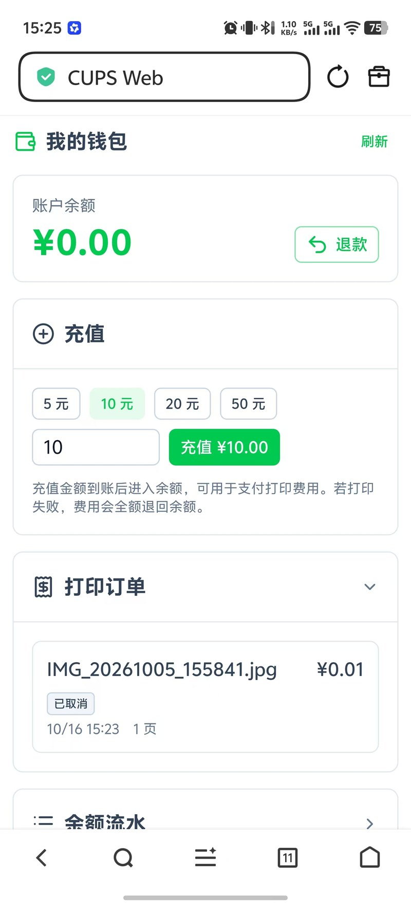<br/><b>我的钱包</b><br/><sub>余额、充值、订单与流水（默认收起）</sub></td>
    <td align="center" width="25%"><br/><b>支付宝里授权完的那一页</b><br/><sub>告诉用户回浏览器继续</sub></td>
    <td align="center" width="25%">&nbsp;</td>
  </tr>
</table>
</div>

几个刻意的设计，从截图上能直接看出来：

- **落地页只给「选打印机 + 选模式」**。手机屏小，一上来就把上传区、十几个参数、预览、费用全堆出来，用户不知道从哪儿下手。
- **登录页默认只有「支付宝登录」**，密码登录收进「已有账号？管理员登录」。下面还有一块「要打印的文件在微信 / QQ 里？」的折叠指引 —— 那是最常见的第一步卡点。
- **付款是即时反馈的**。「确认支付」在余额不足时会明确写出两条出路（去充值 / 改选支付宝），而不是让你对着一个灰按钮猜。
- **复印页会告诉你原件放哪儿**，并把「进稿器里有没有纸」当场报出来（截图里是「未检测到原件」）。复印的两道护栏见 [远程复印](#远程复印扫描--打印)。

### 管理端（桌面）

<div align="center">
<table>
  <tr>
    <td align="center" width="50%"><br/><b>系统管理</b> —— 九个板块各是一层子页</td>
    <td align="center" width="50%">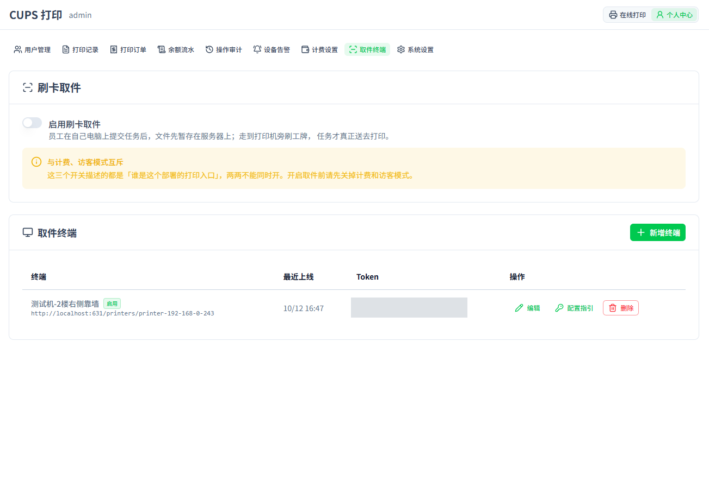<br/><b>取件终端</b> —— 开关、终端登记与最近上线（token 已打码）</td>
  </tr>
  <tr>
    <td align="center" width="50%">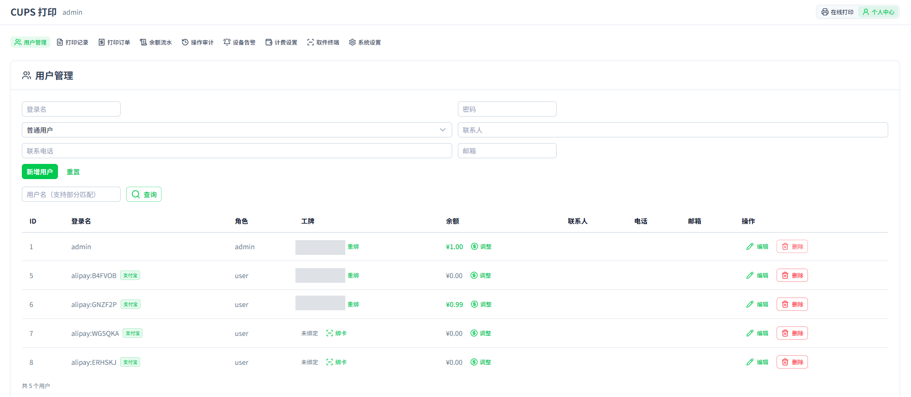<br/><b>用户管理</b> —— 角色、工牌、余额（工牌号已打码）</td>
    <td align="center" width="50%">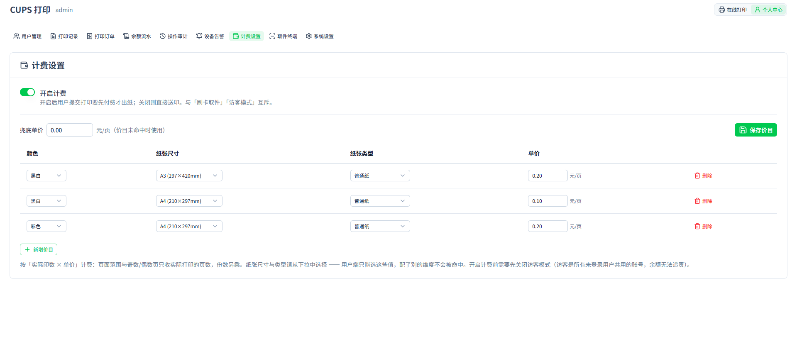<br/><b>计费设置</b> —— 计费开关、兜底单价与价目表</td>
  </tr>
  <tr>
    <td align="center" width="50%">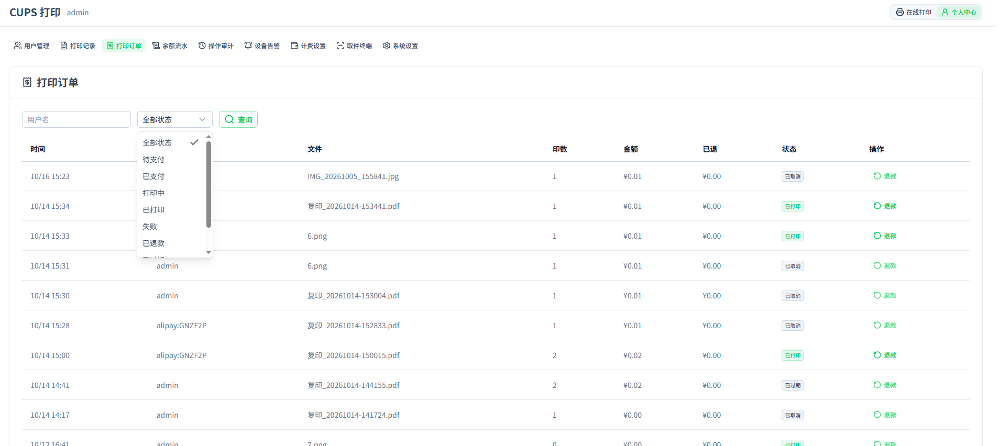<br/><b>打印订单</b> —— 全站订单、状态筛选与退款</td>
    <td align="center" width="50%">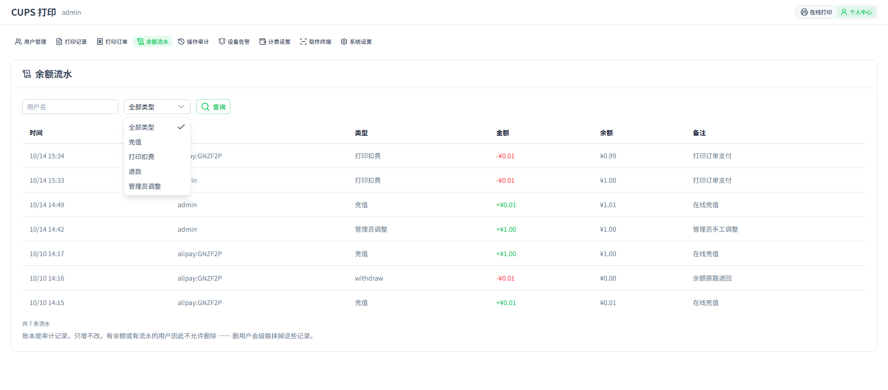<br/><b>余额流水</b> —— 只增不改的账本</td>
  </tr>
</table>
</div>

> 📷 截图里的**取件终端 token 与员工工牌号已打码** —— 它们分别等同于终端口令和门禁凭据。

## ✨ 功能特性

### 三种运行模式（三选一）

系统怎么「收钱 / 放行」由管理端开关决定，三者**互斥**：

| 模式 | 开关 | 适合谁 | 提交之后 |
| --- | --- | --- | --- |
| **计费模式** | `billing_enabled` | 自助打印门店 | 落成订单，**付款后**才送印 |
| **刷卡取件模式** | `pull_mode_enabled` | 企业 / 学校内网 | 任务暂存为「待取件」，**刷工牌后**才送印 |
| **免费模式**（默认） | 两个都关 | 家庭 / 小办公室 | 提交即送印，不记账 |

- 免费模式与改造前完全一致 —— 升级既有部署不会改变任何行为
- 计费模式开启后，`POST /api/print` 会被后端直接 403（防直连绕过下单与扣款），订单成为唯一通道
- 刷卡取件模式对**复印不生效**：复印的人此刻就站在打印机旁边等纸，再要求刷卡是纯粹的重复劳动，因此复印始终直接出纸

另有一个正交的 **「访客模式」**（`guest_mode`）：开启后所有未登录访客共用一个账号，连登录都省了。它与**计费互斥** —— 没人认领的账号没法有余额、也没法对账。

### 打印能力

- **多格式支持**：PDF、图片（JPG/PNG/GIF/HEIC）、Office 文档（doc/docx/xls/xlsx/ppt/pptx）、OFD、纯文本
- **自动转换**：Office 文档通过 LibreOffice 转 PDF；OFD 通过内置 Java 转换器（基于 ofdrw）转 PDF；文本/图片在服务端渲染为 PDF
- **多图片合并打印**：一次选择多张图片自动合并为一份 PDF
- **专用流程**：文字速印（粘贴文字直接打）、发票打印（多张发票合并到一页）、身份证打印（正反面拼到一张纸）
- **打印选项**：份数、单双面、彩色/黑白、纸张大小、纸张类型、页面方向、页码范围、缩放、镜像打印、N-up 拼版、水印
- **实时预览**：支持 PDF 预览、纸张方向的可视化预览、页数估算
- **定时打印**：可预设时间自动提交（⚠️ 该功能目前**未接入计费**）
- **大图处理**：手机拍的照片先下采样再嵌入 PDF，避免超大文件拖垮打印机

### 远程复印（扫描 + 打印）

原件放在打印机上，手机里点一下就把纸扫进来打出去 —— 走 **eSCL / AirScan** 协议直接控制扫描仪，不经过电脑。

- **两种放稿方式**：玻璃板（一次一页）或进稿器（可多页、可双面），界面上可选
- **双重空纸检测**：下任务前看进稿器是否显式上报为空（只是**提示**，部分机型常年误报，用户确认后可越过）；拿到件后还会检查**整份扫描件是不是全白**（这一道才是权威判据 —— 空进稿器与空玻璃板都会安静地交回一张白页，设备既不报错也不终止任务）
- **一次扫描，页数先定**：扫描发生在请求内，页数在扣款之前就完全确定，不存在「预估页数与实付不符」
- 打印机不支持 eSCL 时，复印页会给出明确原因，而不是让你点一个必然失败的按钮

### 支付宝登录与支付

顾客是陌生人、只来一次，**任何要填表的注册都会被放弃**，所以没有用密码注册，也没有用短信验证码（要花钱）。取而代之的是支付宝授权登录与支付宝支付：

- **扫码即登录**：走 `auth_base` 静默授权，用户看不到确认页，扫一下就拿到一个稳定身份（用 `open_id`，官方已明确 `user_id` 会逐步回收）
- **授权在支付宝里做，会话交回浏览器**：支付宝的 webview 里选不到微信 / QQ 发来的文件、PDF 预览也起不来，所以真正传文件、付款都在浏览器里完成。登录页上那块「要打印的文件在微信 / QQ 里？」的折叠指引就是为最常见的第一个卡点准备的
- **顾客唯一的身份凭据是他的用户名**，个人中心会原样显示并提供复制按钮 —— 退款、对账时管理员要靠它找人
- **两种收款方式按设备分流**：手机走手机网站支付（当前标签跳收银台，付完自动跳回），电脑走电脑网站支付（收银台显示二维码可扫）
- **没有公网回调也能结算**：靠 `alipay.trade.query` **主动查单** —— 用户轮询时顺带查一次（几秒内界面就变），后台每 30 秒兜底巡检一次
- **余额钱包**：充值、余额支付、以及**原路退款**（只退「充进来还没花掉」的部分 —— 打印花掉的、管理员手工调额的钱没有对应的渠道交易，退不出去）
- 配置全部走环境变量（私钥不进数据库），步骤见 [支付宝正式环境配置手册](docs/支付宝正式环境配置手册.md)

> ⚠️ **微信支付尚未实现**，这是有意的：微信的产品选型与资质门槛完全不同，代码里只留了锚点，见 [docs/wechat-pay.md](docs/wechat-pay.md)。

### 刷卡取件（企业内网拉式打印）

员工在电脑上正常提交打印，任务**先不出纸**，暂存在服务器上；走到打印机旁刷一下工牌，才把**该员工在这台打印机上**排队的任务释放出去。

- **任务归属明确**：提交时选的哪台，就只能在那台刷卡取件 —— 换来的是参数绝不会打错（进纸盒、A3、双面都在目标机上真实存在）
- **刷多次不会打多份**：释放是一次带条件的原子更新（`WHERE user_id + printer_uri + status='held'`），第二次刷卡匹配 0 行
- **打印机离线或送印失败 → 退回「待取件」**，而不是判失败：员工没付钱，任务不该丢，而且可以再刷一次
- **绑卡三种方式**：工位上的读卡器刷卡捕获（推荐）、到打印机旁的终端刷卡、手抄卡号 UID 批量发卡
- **终端只认 token**：每台终端一个不透明凭据，写在终端机器的配置文件里；终端会给 token 加速率限制，每次释放尝试（含失败原因）都写审计日志
- **两种终端程序都支持**：PC/SC 读卡器（`scripts/kiosk/kiosk.py`，如 ACR122U，读统一 UID、没有键盘布局问题）或键盘模拟读卡器（`cmd/kiosk`，纯 Go，CI 交叉编译，装到树莓派上零运行时依赖）
- **无屏也能用**：终端默认不带屏幕，靠**蜂鸣器声码 + 双色灯**区分「成功 / 卡未登记 / 这台没你的任务 / 打印机离线 / 终端已停用」五种结果

> 🧰 **怎么搭起来、员工怎么用** → [刷卡取件怎么搭、怎么用](#kiosk-howto)（含终端程序在哪、怎么装、怎么配）。
>
> ⚠️ **买读卡器之前必须先验卡型**：企业工牌常见 13.56MHz Mifare/DESFire，而廉价读卡器多是 125kHz EM4100，两者不通用。完整的现场部署步骤见 [刷卡取件终端部署手册](docs/刷卡取件终端部署手册.md)。

### 运维：设备告警与操作审计

- **设备告警**：直连探测打印机（而不是听 CUPS 队列自报），识别 11 类异常 —— 设备不可达、缺纸、卡纸、门未开、耗材耗尽、耗材不足、纸快没了、废粉盒满、出纸盘满、队列被暂停、其它。分 `error` / `warning` 两级，推送到**企业微信 / 钉钉 / 飞书**或任意 webhook，支持去重、静音与重复提醒间隔
- **操作审计**：记下管理员做了什么 —— 改设置、调价目、改用户、调余额、退款、装驱动、绑卡、建终端……（写成「谁、对什么、从什么改成什么」）
- **打印机状态不撒谎**：CUPS 报的「队列状态」与打印机的「真实状态」在界面上**分开显示**。一台离线打印机在 CUPS 眼里照样是 `idle`、墨量照常端出上次的缓存值 —— 所以系统会按 `device-uri` 直连设备去问，不可达时顶上一条红色警告，并把墨量标成「缓存值 · 打印机离线」

### 打印机驱动

镜像内预装了 Debian `printer-driver-all` 等通用驱动包，覆盖大部分常见打印机。对于特定品牌打印机，提供**按需手动安装**的驱动脚本和 Web 管理界面：

**预装通用驱动**（开箱即用）：

- `printer-driver-all`：Debian 维护的驱动 meta 包，包含 splix、c2050、m2300w、ptouch 等
- `printer-driver-cups-pdf`：虚拟 PDF 打印机
- `printer-driver-escpr`：Epson ESC/P-R 标准款（大部分 Epson 喷墨老机型）
- `printer-driver-foo2zjs`：ZjStream / Hiperc / OAKT 协议（部分 HP / Konica / Minolta 老款激光机）
- `printer-driver-brlaser`：Brother 老款激光机
- `foomatic-db-compressed-ppds` + `openprinting-ppds`：海量 PPD 库
- `hplip` + `hpijs-ppds` + `hp-ppd`：HP 全系打印套件
- `ipp-usb` + CUPS 内置 driverless：IPP Everywhere / AirPrint / Mopria 自动识别

**可选厂商驱动**（通过 Web 界面或命令行按需安装，安装后自动持久化）：

| 驱动                  | 命令名               | 架构                  | 适用机型                                     |
| --------------------- | -------------------- | --------------------- | -------------------------------------------- |
| Canon UFR II          | `canon-ufr2`       | amd64 / arm64         | i-SENSYS LBP/MF、imageCLASS、imageRUNNER 等  |
| Canon CAPT            | `canon-capt`       | 全架构 🔧             | LBP2900 / LBP2900B                           |
| HP LaserJet 1020 固件 | `hp-laserjet1020`  | 全架构                | HP LaserJet 1020 / 1020 Plus                 |
| HP foo2zjs 固件       | `foo2zjs-firmware` | 全架构 🔧             | HP LaserJet 1000/1005/1018/P1005/P1006/P1505 |
| Epson ESC/P-R 2       | `escpr2`           | amd64 / armhf / arm64 | ET-18100, L8050, L8160, WF-7840 等           |
| Epson 国行驱动        | `epson-cn`         | 仅 amd64              | L380, L455 等国行机型                        |
| Konica Minolta bizhub | `konica-bizhub`    | amd64 / arm64         | bizhub 3000MF                                |
| Sharp PostScript      | `sharp`            | 全架构                | MX-C2622R 等 PostScript 打印机               |
| Gutenprint            | `gutenprint`       | amd64 / arm64         | 大量 Epson/Canon/HP 老机型                   |

> 🔧 = 需要在容器内现场编译，耗时较长（几分钟到十几分钟，ARM 小主机更慢）。其他驱动是下载 + 解包安装，通常几十秒内完成。
>
> Epson ESC/P-R 2 在 amd64 / armhf 上直接安装预编译包，在 **arm64 上会回退到源码编译**，也需要几分钟。
>
> 「架构」列就是实际的硬限制：厂商没有提供对应架构的二进制时，Web 界面会把该驱动的「安装」按钮**禁用**并提示原因，不会让你点一个必然失败的按钮。

### 驱动管理（Web 界面）

驱动管理页面**仅管理员可见**（登录后导航栏的「驱动」入口）：

- **自动检测**：扫描 USB / 网络打印机，自动匹配推荐驱动
- **一键安装**：检测到打印机后一键安装驱动，并自动 `lpadmin` 添加到 CUPS（默认纸张设为 A4）
- **驱动列表**：查看所有可用驱动的安装状态、安装时间与支持架构，一键安装 / 卸载
- **上传自定义驱动**：支持上传 PPD 文件（`.ppd`）或 Debian 包（`.deb`），仅这两种扩展名
- **驱动持久化**：安装的驱动文件自动快照到 `.drivers` 持久卷，容器重建后自动恢复

#### 安装过程是异步的，请耐心等待

点击「安装」后接口会**立刻返回**，真正的安装在后台执行，页面上会出现一个进度卡片，每 2 秒刷新一次并**实时展示编译 / 安装日志**：

- 需要编译的驱动（Canon CAPT、HP foo2zjs 固件、arm64 上的 Epson ESC/P-R 2）可能要**几分钟到十几分钟**，页面一直显示滚动日志是正常的，**不是卡住了**
- 这期间请**不要刷新页面、不要重复点击**。刷新虽然不会中断后台安装，但页面上的实时日志会丢失，只能改用 `docker compose logs -f cups` 观察
- 后台任务的硬超时是 30 分钟，页面等待上限 35 分钟

#### 同一时刻只能跑一个驱动任务

apt / dpkg 本身持有全局锁，并发安装只会互相失败。因此后端限制**同时只允许一个驱动任务**（安装 / 卸载 / 一键安装并添加），任务进行中再发起第二个会被直接拒绝，并提示「已有驱动任务正在执行，请等待其完成后重试」；有任务在跑时上传 `.deb` 也会被同样拒绝。

#### `.ppd` 与 `.deb` 都会自动恢复

| 上传类型 | 容器重启后                                                                                  |
| -------- | ------------------------------------------------------------------------------------------- |
| `.ppd` | ✅ 自动恢复（文件被快照到`.drivers`，启动时还原到 `/usr/share/cups/model/custom`）      |
| `.deb` | ✅ 自动重新安装（原件归档到`.drivers/custom-deb/packages/`，启动时用 `dpkg -i` 装回来） |

`.deb` 的真正安装动作发生在包内的安装脚本里，光把文件拷回来并不能让驱动生效 —— 所以它走的是"归档整个包、重启时重新安装一遍"的路子，而不是逐个文件还原。重复安装是安全的：已经装上且版本不更旧的包会被跳过。

> 💡 如果某个上传的 `.deb` 始终装不上，它会在每次容器启动时重试一遍（日志里能看到告警）。想彻底移除它，删掉宿主 `./.drivers/custom-deb/packages/` 下对应的文件即可。

> ⚠️ **上传 `.deb` 的安全风险**：安装 `.deb` 时 dpkg 会以 **root 身份执行包内的安装脚本**，等价于在容器里执行任意代码，并且会改动容器的系统状态。这是有意保留给管理员的能力，但也意味着**管理员账号密码等同于容器的 root 凭据**。请只上传来源可信的 `.deb`，并且**不要在不可信的多人环境下开放管理员账号**（普通 `user` 角色看不到也调不到驱动接口）。每次上传都会把上传者用户名写进容器日志，便于事后审计。

> ⚠️ **驱动持久化依赖 `./.drivers` 卷**：手动安装的第三方驱动全部快照在这个目录里。**删掉它（或忘记挂这个卷）= 丢失所有手动安装的驱动**，重启后需要在「驱动」页面重新装一遍。备份时别漏了它。

也可以通过命令行安装驱动（命令行是同步执行的，会一直占用终端直到结束）：

```bash
# 查看可用驱动
docker exec cups driver-list

# 安装驱动
docker exec cups driver-install canon-ufr2

# 查看已安装驱动
docker exec cups driver-list --installed

# 卸载驱动
docker exec cups driver-remove canon-ufr2
```

### 用户与权限

- **多用户系统**：支持 `admin` / `user` 两种角色
- **默认管理员**：首次启动自动创建 `admin/admin`，`admin` 账号受保护无法被删除或重命名
- **登录方式**：账号密码，或**支付宝扫码授权登录**（顾客侧默认没有注册入口，首次扫码自动建号）
- **IC 卡绑定**：一个员工可绑一张卡（唯一约束，同一张卡不能绑两个人），绑了之后就能刷卡取件
- **打印记录**：完整保存每次打印的文件、页数、份数、双面/彩色选项、状态等

### 管理后台

登录后进入「个人中心 → 系统管理」，是一个落地菜单，九个板块各是一层子页：

| 子页 | 内容 |
| --- | --- |
| **用户管理** | 创建 / 编辑 / 删除用户、改角色与联系信息、调整余额、**刷卡绑卡**；可按用户名与卡号查询 |
| **打印记录** | 全站打印任务与文件下载 |
| **打印订单** | 计费订单与支付状态，未支付可取消，已支付可手工退款到余额 |
| **余额流水** | 账本审计（充值 / 消费 / 退款 / 管理员调额，只增不改） |
| **操作审计** | 谁改了什么、改前改后 |
| **设备告警** | 缺纸 / 卡纸 / 耗材 / 设备不可达，以及通知渠道配置 |
| **计费设置** | 计费开关、价目表与兜底单价、订单有效期、支付方式、站点地址 |
| **取件终端** | 刷卡取件开关与取件有效期、登记终端、绑定工牌 |
| **系统设置** | 数据保留天数、访客模式、上传上限、自定义 CSS |

（**驱动管理**是单独一个入口，不在系统管理里。）

- **数据保留策略**：按天数自动清理过期打印记录与文件，每小时巡检一次。⚠️ **待取件任务与未终结订单持有的文件会被跳过**，不会被清理误删
- **拆分的原因**：早先这些板块挤在同一页，一进去就并行拉四个「全站」列表（都无上限）；拆开后每页只加载自己那一份，也都改成懒加载，管理端代码不再进首屏包

### 安全

- **Session 认证**：基于 Gorilla `securecookie`（加密 + 签名），密钥自动生成并持久化到数据库
- **CSRF 防护**：对所有非 GET/HEAD/OPTIONS 请求校验 `X-CSRF-Token`
- **跨源防护**：基于 `Sec-Fetch-Site`（缺失时退化为 `Origin` vs `Host`）拒绝跨站写请求，被拒时返回**结构化 JSON** 而不是一句看不懂的纯文本
- **密码安全**：bcrypt 加密存储
- **登录限流**：按「来源 IP + 用户名」计数，连续失败若干次后锁定一段时间
- **Cookie 属性**：`HttpOnly` + `SameSite=Lax` + 24 小时有效期；是否带 `Secure` 由 `COOKIE_SECURE` 三态控制（`auto` 按请求判断 / `true` 恒开 / `false` 恒关）

> ⚠️ 默认管理员密码是 `admin/admin`，**部署到公网前必须先改掉**。

## 🛠️ 技术栈

- **后端**：Go 1.26 · Gorilla Mux · PostgreSQL（`pgx/v5` 的 `database/sql` 兼容层）
- **打印协议**：[OpenPrinting/goipp](https://github.com/OpenPrinting/goipp)（IPP）—— 提交打印、查询任务、直连探测打印机状态
- **扫描协议**：**eSCL / AirScan**（远程复印时直接驱动打印机上的扫描仪）
- **支付**：支付宝开放平台（手机网站支付 / 电脑网站支付 / 当面付，RSA2 签名、回调验签、主动查单）；微信支付只有锚点，**未实现**
- **取件终端**：Python + `pyscard`（PC/SC 读卡器）或纯 Go 二进制（键盘模拟读卡器，适合树莓派）
- **前端**：Vue 3 · Vite 7 · [Nuxt UI v4](https://ui.nuxt.com/) · Tailwind CSS v4 · Vue Router（hash 模式）· `pdfjs-dist` 预览
- **文档转换**：LibreOffice（Office → PDF）· [ofdrw](https://github.com/ofdrw/ofdrw)（OFD → PDF，Java 21）· Ghostscript（PDF 标准化与缩放）
- **打印服务**：[CUPS](https://www.cups.org/)（源码编译 2.4.x，覆盖 apt 版本）

## 🚀 快速开始

提供两种部署方式：

- [Docker 部署](#docker-部署)（推荐，一键拉起 CUPS + Web）
- [二进制部署](#二进制部署)（适合已有 CUPS 服务的场景）

---

## Docker 部署

### 前置要求

- Docker 与 Docker Compose
- USB 打印机（若使用本地打印机）

### 1. 创建 `docker-compose.yml`

```yaml
services:
  cups:
    image: mars666613/cups-web:latest
    container_name: cups
    user: root
    hostname: CUPS
    # mDNS/DNS-SD 依赖局域网组播，桥接模式下发现不了网络打印机、
    # AirPrint 也广播不出去，必须用 host 网络（issue #107）
    network_mode: host
    security_opt:
      - apparmor:unconfined
    environment:
      - CUPSADMIN=${CUPSADMIN:-print}
      - CUPSPASSWORD=${CUPSPASSWORD:-print}
      - TZ=${TZ:-Asia/Shanghai}
      # host 网络下 Web 直接监听宿主端口，默认 1180（与旧版端口映射一致）
      - LISTEN_ADDR=${LISTEN_ADDR:-:1180}

      # ── 数据库（必填）────────────────────────────────────────────
      # ⚠️ 没配这一项容器起不来：已不再支持 SQLite，没有回退。
      # 值写在同目录的 .env 里（已 gitignore）。🚫 不要把带密码的连接串直接写在
      # 这一行 —— docker-compose.yml 是提交进 git 的，写了就等于把生产库密码推上去。
      # ⚠️ 各店走公网连中心库时 sslmode 要用 require 或更高，否则密码与订单明文过网。
      - DATABASE_URL=${DATABASE_URL:-}
      # 每个实例开多少条连接。所有店加起来不能超过服务端 max_connections（PG 默认 100）
      - DB_MAX_CONNS=${DB_MAX_CONNS:-10}

      # ── 支付宝（可选）────────────────────────────────────────────
      # 四项齐全时支付宝才会出现在支付方式里（缺任何一项则该渠道不展示，
      # 不会出现「点了必然失败」的按钮）。密钥同样写在 .env 里。
      # ⚠️ ALIPAY_PUBLIC_KEY 是【支付宝公钥】，不是应用公钥 —— 传错的话所有验签
      #    都失败，而报错只有「验签失败」四个字。
      - ALIPAY_APP_ID=${ALIPAY_APP_ID:-}
      - ALIPAY_PRIVATE_KEY=${ALIPAY_PRIVATE_KEY:-}
      - ALIPAY_PUBLIC_KEY=${ALIPAY_PUBLIC_KEY:-}
      # 生产不要设这一项（留空即用正式网关）；沙箱联调才指到 sandbox 地址
      - ALIPAY_GATEWAY=${ALIPAY_GATEWAY:-}
    volumes:
      - ./.etc:/etc/cups
      - ./.uploads:/uploads
      - ./.drivers:/opt/cups-drivers/data
      - /dev/bus/usb:/dev/bus/usb
      - /run/udev:/run/udev:ro
    device_cgroup_rules:
      - 'c 189:* rmw'
    # 特权模式：ARM / 嵌入式平台上 libusb 需要完整 sysfs 访问才能枚举 USB
    # 打印机（issue #110）。如果你确认 x86 平台不需要，可注释掉这行。
    privileged: true
    restart: unless-stopped
```

也可直接下载仓库内的 `docker-compose.yml`：

```bash
wget https://raw.githubusercontent.com/Mars666613/cups-web/main/docker-compose.yml
```

> 💡 镜像标签：`latest` = 最新正式发行版（v* tag）；`dev` = main 分支最新构建（每次 push 更新，尝鲜用）。`docker-compose.yml` 默认用 `latest`，想试 dev 版本时把 `image: mars666613/cups-web:latest` 改成 `image: mars666613/cups-web:dev` 即可。

### 2. 配置环境变量

在同目录创建 `.env`。**`DATABASE_URL` 是必填的**，其余可留空：

```bash
CUPSADMIN=print
CUPSPASSWORD=your_cups_password
TZ=Asia/Shanghai

# 必填：中心 PostgreSQL 连接串（没有 SQLite 回退）
DATABASE_URL=postgres://cupsweb:密码@127.0.0.1:5432/cupsweb?sslmode=disable

# 可选：支付宝，四项齐全才会出现在支付方式里
# ALIPAY_APP_ID=
# ALIPAY_PRIVATE_KEY=
# ALIPAY_PUBLIC_KEY=
```

> 💡 **建表不用你管，建库要。** 表结构在仓库里的 [`internal/store/schema.sql`](internal/store/schema.sql)，被 `//go:embed` 嵌进二进制，**程序每次启动都自动整份执行一遍**（全是 `IF NOT EXISTS`，重复跑无副作用 —— 所以升级新版本只要重启）。你要做的只有一件事：把空库建出来，**而且必须带 `C` collation**：

```sql
CREATE DATABASE cupsweb LC_COLLATE 'C' LC_CTYPE 'C' TEMPLATE template0;
```

> ⚠️ **漏了 collation 的后果**：若集群默认是 ICU 非确定性 collation，`username` 的唯一约束会把 `Admin` 与 `admin` 判为冲突，而且 `WHERE username = ?` 变成大小写不敏感 —— **能用 `ADMIN` 登录**。这个坑在开发机上不一定复现，取决于集群怎么建的。
>
> 想手动建表也可以（幂等，安全）：`psql -d cupsweb -f internal/store/schema.sql`
>
> 🔧 **单机试跑**没有现成的 PostgreSQL？最省事的是加一个 `postgres` 服务到上面的 compose 里，或直接用 `docker run -d -e POSTGRES_PASSWORD=... -p 5432:5432 postgres:17`。注意容器里的 `127.0.0.1` 指的是容器自己 —— 连宿主上的库要写宿主的局域网 IP（host 网络模式下 `127.0.0.1` 可用）。
>
> 📖 完整变量清单见 [环境变量](#环境变量)，模板见仓库里的 [`.env.example`](.env.example)。


### 3. 启动服务

```bash
docker compose up -d
```

### 4. 安装打印机驱动（按需）

大部分打印机靠镜像预装的通用驱动即可直接使用，只有特定品牌机型才需要这一步。

通过 Web 界面安装（推荐）：

1. 访问 [http://localhost:1180](http://localhost:1180)，使用 `admin/admin` 登录
2. 点击导航栏「驱动」进入驱动管理页面（仅管理员可见）
3. 点击「扫描打印机」自动检测已连接的打印机
4. 对检测到的打印机点击「一键安装并添加」

> ⏳ 安装是**后台异步**执行的，页面上会实时滚动安装日志。需要编译的驱动可能要十几分钟，请不要刷新页面或重复点击；同一时刻只能有一个驱动任务在跑。详见 [驱动管理（Web 界面）](#驱动管理web-界面)。

或通过命令行安装：

```bash
docker exec cups driver-install canon-ufr2
```

### 5. 配置打印机

如果没有通过上面的自动检测添加打印机，也可以手动配置：

访问 CUPS 管理界面：[http://localhost:631](http://localhost:631)，使用 CUPS 管理员账号登录并添加打印机。

> ⚠️ **重要**：添加打印机后，必须在 CUPS 管理后台将其设为 **Shared（共享）** 状态，否则 Web 端无法发现该打印机。

### 6. 访问 Web

浏览器打开 [http://localhost:1180](http://localhost:1180)，使用默认账号登录：

- 用户名：`admin`
- 密码：`admin`

> ⚠️ **首次登录请立即修改默认密码**。

---

## 二进制部署

适合已有 CUPS 服务的场景。

> ⚠️ **裸二进制部署的能力边界**：二进制里只有 Web 服务本身，**CUPS 需要你自己在宿主机上安装并配置好**（含打印机驱动）。镜像特有的功能在这里都不可用：
>
> - **驱动管理页面用不了**：驱动的安装 / 卸载脚本（`driver-install` 等）和持久化目录 `/opt/cups-drivers` 是**镜像内置**的。裸二进制环境下这些文件不存在，「驱动」页面里所有驱动都会显示为未安装、「安装」按钮被禁用并提示「当前镜像缺少该驱动的安装脚本」；如果强行调用接口，任务会以 `no such file or directory` 失败。请直接用宿主机的包管理器（`apt install printer-driver-*`）或 CUPS 管理界面装驱动。
> - **自动检测打印机**依赖 `lpinfo`（`cups-client` 包），缺失时「扫描打印机」会报 `failed to detect printers`。
> - **Office / OFD / PDF 标准化**依赖 LibreOffice、Java、Ghostscript，需要自行安装（见下文）。

### 1. 下载二进制

从 [GitHub Releases](https://github.com/Mars666613/cups-web/releases) 下载对应平台的二进制：

| 平台    | 架构    | 文件名                         |
| ------- | ------- | ------------------------------ |
| Linux   | amd64   | `cups-web-linux-amd64`       |
| Linux   | arm64   | `cups-web-linux-arm64`       |
| Linux   | armv7   | `cups-web-linux-armv7`       |
| Linux   | loong64 | `cups-web-linux-loong64`     |
| macOS   | amd64   | `cups-web-darwin-amd64`      |
| macOS   | arm64   | `cups-web-darwin-arm64`      |
| Windows | amd64   | `cups-web-windows-amd64.exe` |

```bash
wget https://github.com/Mars666613/cups-web/releases/latest/download/cups-web-linux-amd64
chmod +x cups-web-linux-amd64
```

### 2. 配置并运行

```bash
export CUPS_HOST=localhost:631
export DATABASE_URL='postgres://cupsweb:密码@127.0.0.1:5432/cupsweb?sslmode=disable'
export UPLOAD_DIR=./uploads
export LISTEN_ADDR=:8080

./cups-web-linux-amd64
```

或使用命令行参数（优先级高于环境变量）：

```bash
./cups-web-linux-amd64 -addr :8080
```

> ⚠️ **OFD 打印仅在 Docker 镜像中开箱即用**。二进制部署若需支持 OFD，需要另行安装 Java 运行时（镜像内为 Java 21）并把 `ofd-converter.jar` 放到 `/ofd-converter.jar`（或手动改源码中的路径）。

### 3. 访问 Web

浏览器打开 [http://localhost:8080](http://localhost:8080)，使用 `admin/admin` 登录。

---

## ⚙️ 配置说明

### 环境变量

| 变量名                     | 说明                                                                                                             | 默认值                 |
| -------------------------- | ---------------------------------------------------------------------------------------------------------------- | ---------------------- |
| `LISTEN_ADDR`            | Web 服务监听地址                                                                                                 | `:8080`              |
| `DATABASE_URL`           | PostgreSQL 连接串，**必填**（没有 SQLite 回退）                                                            | 无                     |
| `DB_MAX_CONNS`           | 每个实例向数据库开多少条连接。所有实例加起来不能超过服务端`max_connections`                                    | `10`                 |
| `UPLOAD_DIR`             | 上传文件目录                                                                                                     | `uploads`            |
| `CUPS_HOST`              | CUPS 服务地址（Docker 内默认`localhost`）                                                                      | `localhost`          |
| `CUPSADMIN`              | CUPS 管理员用户名                                                                                                | `print`              |
| `CUPSPASSWORD`           | CUPS 管理员密码                                                                                                  | `print`              |
| `TZ`                     | 时区                                                                                                             | `Asia/Shanghai`      |
| `COOKIE_SECURE`          | 会话 / CSRF cookie 的`Secure` 属性：`auto`（缺省，按每个请求的实际协议判定）/ `true` 恒开 / `false` 恒关 | `auto`               |
| `TRUSTED_ORIGINS`        | 额外放行的来源，逗号分隔（形如`https://print.example.com`）。仅在跨源防护误拦时需要                            | 空                     |
| `PRINTER_HOST_ALLOWLIST` | 打印机 URI 的主机白名单，逗号分隔。收紧 SSRF 面                                                                  | 空（不限制）           |
| `PRINTER_BLOCK_PRIVATE`  | `true` 时拒绝指向私网地址的打印机 URI                                                                          | `false`              |
| `OFD_CONVERTER_JAR`      | OFD → PDF 转换器 jar 路径                                                                                       | `/ofd-converter.jar` |
| `ALIPAY_APP_ID`          | 支付宝开放平台应用的 AppID                                                                                      | 空（不出支付宝渠道）   |
| `ALIPAY_PRIVATE_KEY`     | 应用私钥（PKCS8 / PKCS1、PEM 或裸 base64 均可）                                                                 | 空                     |
| `ALIPAY_PUBLIC_KEY`      | ⚠️ **支付宝公钥**，不是应用公钥                                                                                 | 空                     |
| `ALIPAY_GATEWAY`         | 只用于沙箱联调；生产留空即用正式网关                                                                            | 空（正式网关）         |
| `PAYMENT_MOCK`           | `1` 时启用 mock 支付渠道（**仅供本地联调**，别在生产开）                                                        | 关                     |

> 💡 `.env.example` 里带注释的是数据库与支付宝配置。`CUPSADMIN` / `CUPSPASSWORD` / `TZ` 在镜像里都已有内置默认值，不写也能启动。
>
> ⚠️ **`DATABASE_URL` 是必填的** —— 数据库已改为外部的 PostgreSQL，程序不再自带 SQLite。没配这一项容器会直接启动失败并在日志里打印格式示例。
>
> 💡 **建库时要指定 `C` collation**：`CREATE DATABASE cupsweb LC_COLLATE 'C' LC_CTYPE 'C' TEMPLATE template0;`。不指定的话，若集群默认是 ICU 非确定性 collation，用户名会变成大小写不敏感（能用 `ADMIN` 登录）。表结构不用手动建，程序启动时会自动执行。
>
> 💡 `UPLOAD_DIR` 的默认值是**相对路径**，镜像内工作目录是 `/`，所以容器里实际落在 `/uploads/`，正好对应下面的卷映射，通常不需要显式设置。
>
> 💡 `CUPS_HOST` 单容器化后默认就是 `localhost`（cupsd 与 Web 同容器），一般无需设置；只有把 Web 指向**另一台机器**上的 CUPS 时才需要，可写 `host` 或 `host:port`（省略端口时自动补 `631`）。
>
> 💡 `COOKIE_SECURE` 缺省的 `auto` 会在直连 HTTPS（`r.TLS`）或反代上报 `X-Forwarded-Proto: https` 时自动给 cookie 加 `Secure`，HTTP 内网部署行为不变。若代理错误地上报了 `https` 而浏览器实际走 HTTP，会出现「登录后立刻掉线」，此时显式设 `COOKIE_SECURE=false`。
>
> 💡 `TRUSTED_ORIGINS` 通常**不需要**设置。反向代理下的跨源误拦已由 `X-Forwarded-Host` 自动处理，详见 [docs/reverse-proxy.md](docs/reverse-proxy.md)。

### 命令行参数

| 参数      | 说明                                |
| --------- | ----------------------------------- |
| `-addr` | 监听地址，优先级高于`LISTEN_ADDR` |

### 默认端口

- CUPS：`631`（管理界面 + IPP 协议）。Docker 部署使用 host 网络模式（[Issue #107](https://github.com/hanxi/cups-web/issues/107)），cupsd 直接占用宿主机 `631`
- Web：二进制部署默认监听 `8080`；Docker 部署由 `LISTEN_ADDR` 环境变量决定，`docker-compose.yml` 默认 `:1180`（与旧版桥接时代的端口映射保持一致）

### 数据持久化目录

Docker 默认卷映射：

| 宿主机路径     | 容器路径                   | 说明                                                        |
| -------------- | -------------------------- | ----------------------------------------------------------- |
| `./.etc`     | `/etc/cups`              | CUPS 配置（打印机、PPD 等）                                 |
| `./.uploads` | `/uploads`               | 上传的原始文件与转换后 PDF                                  |
| `./.drivers` | `/opt/cups-drivers/data` | 手动安装的打印机驱动快照（⚠️ 删除即丢失全部手动装的驱动） |

> ⚠️ **数据库不在容器里。** 本分支已改为连接外部 PostgreSQL（`DATABASE_URL`），
> 原先的 `./.data:/data` 卷随之删除 —— 容器里不再有任何东西写 `/data`。
> 宿主机上的 `./.data` 目录可以留着不管（里面只有旧的 `cups-web.db`），
> 确认不需要回滚之后再删。

此外还有两个**非数据类**的挂载，用于 USB 打印机识别与热插拔：

| 宿主机路径       | 容器路径              | 说明                                                                                              |
| ---------------- | --------------------- | ------------------------------------------------------------------------------------------------- |
| `/dev/bus/usb` | `/dev/bus/usb`      | 以**目录**方式挂载（而不是 `devices:`），这样打印机后开机时新建的设备节点能实时传播进容器 |
| `/run/udev`    | `/run/udev`（只读） | 让 libusb 读到设备属性，改善识别；宿主机没有该目录时可以删掉这一行                                |

> ⚠️ **从旧版升级注意**：旧版 compose 还挂载了 `/run/dbus/system_bus_socket`（[Issue #94](https://github.com/hanxi/cups-web/issues/94)，借用宿主机 avahi 广播 AirPrint），新版已**移除**（[Issue #107](https://github.com/hanxi/cups-web/issues/107)）：宿主机没装 avahi-daemon 时，该挂载会让容器内自己的 dbus/avahi 起不来，网络打印机发现与 AirPrint 广播全部失效。host 网络模式下容器内自启的 avahi 已能直接在局域网发现和广播，无需依赖宿主机任何服务。请同步删除你本地 compose 里的这一行。

### 其他 compose 选项说明

| 选项                                     | 为什么需要                                                                                                                                                                                                                                                                                                                                                                                        |
| ---------------------------------------- | ------------------------------------------------------------------------------------------------------------------------------------------------------------------------------------------------------------------------------------------------------------------------------------------------------------------------------------------------------------------------------------------------- |
| `network_mode: host`                   | mDNS/DNS-SD 依赖局域网组播（5353/udp），桥接模式下组播出不去也进不来：容器发现不了局域网网络打印机，手机也搜不到 AirPrint（[Issue #107](https://github.com/hanxi/cups-web/issues/107)）。代价是无法自定义端口映射，CUPS 固定占用宿主 `631`、Web 由 `LISTEN_ADDR` 决定；宿主若自装 avahi-daemon 会与容器内 avahi 抢 5353 端口，且宿主 avahi 无法替容器广播（两条独立 D-Bus 总线），需停掉宿主侧 |
| `hostname: CUPS`                       | avahi 以`CUPS.local` 在局域网广播 AirPrint / IPP Everywhere 服务                                                                                                                                                                                                                                                                                                                                |
| `LISTEN_ADDR=:1180`                    | host 网络下没有端口映射，让 Web 直接监听宿主`1180`，与旧桥接时代一致，书签 / 反代配置无需改动                                                                                                                                                                                                                                                                                                   |
| `user: root`                           | 容器内要运行 cupsd、`lpadmin`、`dpkg`（驱动安装），还要往 `/usr/lib/cups`、`/usr/share/ppd` 等系统路径写驱动文件                                                                                                                                                                                                                                                                          |
| `security_opt: [apparmor:unconfined]`  | 解除 AppArmor 限制（[Issue #91](https://github.com/hanxi/cups-web/issues/91)）。PVE (Proxmox VE) LXC 等环境下会出现 `apparmor="DENIED"` 导致打印失败；单容器化后它同时也保护 LibreOffice / OFD 转换子进程不被拦截                                                                                                                                                                                |
| `device_cgroup_rules: ['c 189:* rmw']` | 放开 USB 字符设备（major 189）的 cgroup 权限（[Issue #81](https://github.com/hanxi/cups-web/issues/81)）                                                                                                                                                                                                                                                                                           |
| `privileged: true`                     | 特权模式。ARM / 嵌入式平台（树莓派、Amlogic、各类 TV Box 跑 Armbian）上 libusb 需要完整 sysfs 才能枚举 USB 打印机（[Issue #110](https://github.com/hanxi/cups-web/issues/110)）。x86 平台若介意安全隔离可注释掉，仅靠上方 `device_cgroup_rules` 通常已足够                                                                                                                                       |

---

## 📖 使用指南

### 支持的文件格式

| 类型   | 扩展名                                                   | 处理方式                   |
| ------ | -------------------------------------------------------- | -------------------------- |
| PDF    | `.pdf`                                                 | 直接打印                   |
| 图片   | `.jpg` `.jpeg` `.png` `.gif` `.heic`           | 转换为 PDF（支持多张合并） |
| Office | `.doc` `.docx` `.xls` `.xlsx` `.ppt` `.pptx` | 通过 LibreOffice 转换      |
| OFD    | `.ofd`                                                 | 通过 ofdrw 转换            |
| 文本   | `.txt` `.md` `.html`                               | 服务端渲染为 PDF           |

### 打印流程

1. **选打印机** —— 进入打印页时只有打印机下拉与几个模式按钮，选完才展开后面的内容
2. **选一个模式** —— 标准打印 / 文字速印 / 发票打印 / 身份证打印 / 远程复印
3. **准备原件** —— 上传文件、粘贴一段文字，或把纸放到打印机上（复印）
4. **预览 + 调参数** —— 转换后的成品直接在浏览器里渲染出来，页数与费用同时给出
5. **提交**，之后按当前运行模式分叉：

| 运行模式 | 提交之后 |
| --- | --- |
| 免费（默认） | 直接下发 CUPS 出纸 |
| 计费 | 生成订单 → 支付（余额或支付宝）→ **付款到账后**自动送印 → 跳完成页 |
| 刷卡取件 | 暂存为「待取件」→ **走到打印机刷工牌** → 才送印 |

### 管理员功能

完整清单见 [管理后台](#管理后台) 一节的九个板块。最常用的几条：

- **先改掉默认密码** `admin/admin`，再按需要建用户，或开通**支付宝扫码登录**（顾客侧就不用注册了）
- **开店用计费**：在「计费设置」里打开计费、配好价目表与兜底单价
- **企业内部用刷卡取件**：在「取件终端」里打开取件模式、登记终端、给员工绑卡
- **驱动管理**：自动检测打印机、安装/卸载驱动、上传自定义 PPD/deb（后台异步执行 + 实时日志，同时只跑一个任务）

---

<a id="kiosk-howto"></a>

## 🎫 刷卡取件怎么搭、怎么用

企业内网形态：员工在电脑上正常提交打印，任务**先不出纸**，暂存在服务器上；走到打印机旁刷一下工牌，才把**该员工在这台打印机上**排队的任务释放出去。适合企业、学校、机房这类「文件不能无人值守地躺在出纸口」的场景。

### 它由三部分组成

| 角色 | 跑在哪 | 做什么 |
| --- | --- | --- |
| **服务端** | 你现在这台 cups-web | 收任务、暂存、验卡、释放、送印。**不用额外装任何东西** |
| **刷卡终端** | 打印机旁的一台小机器（树莓派 / 任意 Linux 小主机） | 读卡 → 发给服务端 → 按结果响一声 / 亮灯 |
| **读卡器** | 插在那台小机器上 | USB 读卡器，两种类型见下 |

### 第一步：管理端开开关、建终端（5 分钟）

进「**个人中心 → 系统管理 → 取件终端**」：

1. 打开**「启用刷卡取件」**。
   ⚠️ 它与**计费**、**访客模式**互斥 —— 三个开关描述的都是「谁是这个部署的打印入口」，不能同时开，页面上会直接提示要先关掉哪个。
2. 点**「+ 新增终端」**：填名字（如「2 楼打印机旁」）、选它绑定的**打印机**，保存。
3. 列表里会生成一个 **Token**，点复制 —— 第二步要填到终端机器上。同一行的**「配置指引」**按钮里就是下面那份配置文件内容，可以直接照抄。

> 💡 **绑卡用的读卡器不必装在打印机旁**：新增终端时不选打印机（勾「仅用于绑卡」），放在你自己的工位上就行。卡号 UID 是芯片固化的，同一张卡在任何一台 PC/SC 读卡器上读出来都一样。

### 第二步：把终端程序装到打印机旁那台机器上

程序在仓库里，**两个版本，按读卡器类型选一个**：

| 读卡器 | 用哪个 | 说明 |
| --- | --- | --- |
| **PC/SC 读卡器**（ACR122U 等，插上走 pcscd） | [`scripts/kiosk/kiosk.py`](scripts/kiosk/kiosk.py) | **推荐**。读出来的是卡片统一 UID，**不受键盘布局影响** |
| **键盘模拟读卡器**（HID，刷卡相当于敲一串字符） | [`cmd/kiosk/`](cmd/kiosk/) 编译出的二进制 | 纯 Go、零运行时依赖，从 [Releases](../../releases) 下载对应架构的 `cups-kiosk-linux-*`（amd64 / arm64 / armv7 / loong64）即可。⚠️ 它会受机器的**键盘布局**影响，同一张卡在不同机器上可能读出不同字符串 |

两种都有现成的安装脚本与 systemd 单元，都在 [`scripts/kiosk/`](scripts/kiosk/)：`install.sh`（装程序 + 服务）与 `cups-kiosk.service`。install.sh **不替你写配置** —— token 是每台终端独有的。

**以 kiosk.py 为例**，在那台终端机器上：

```bash
# 1. 装依赖
sudo apt install -y pcscd python3-pyscard python3-requests
sudo systemctl enable --now pcscd

# 2. 从部署 cups-web 的那台机器拷程序过去（也可以直接在终端上 git clone 仓库）
scp scripts/kiosk/{kiosk.py,install.sh,cups-kiosk.service} 用户名@终端机器:/tmp/

# 3. 安装：放程序到 /usr/local/bin/cups-kiosk + 装 systemd 单元
sudo /tmp/install.sh /tmp/kiosk.py

# 4. 写配置（内容与管理端「配置指引」一致）
sudo tee /etc/cups-kiosk.conf > /dev/null <<'EOF'
server = http://你的服务器地址:1180
token  = 第一步复制的那串 token
EOF
sudo chmod 600 /etc/cups-kiosk.conf     # token 等同口令，所以只有 root 能读

# 5. 插上读卡器，先单独验一次能不能读到卡（别跳过这步）
sudo systemctl stop cups-kiosk 2>/dev/null || true
sudo /usr/local/bin/cups-kiosk --read   # 刷一张卡，打出 UID 就算通了

# 6. 开机自启
sudo systemctl enable --now cups-kiosk
systemctl status cups-kiosk
```

配置项就四个（`key = value`，`#` 开头是注释）：

| 键 | 说明 |
| --- | --- |
| `server` | 服务端地址，如 `http://192.168.1.22:1180` |
| `token` | 第一步复制的那串 |
| `device` | 可选。插了多个读卡器时，用它名字里的一段来选 |
| `beep_cmd` | 可选。接了蜂鸣器才需要（见部署手册第十一步） |

> ⚠️ **装成服务之后就不要再手工跑 `kiosk.py` 了** —— 两个进程会抢同一张卡，现场表现是满屏 `Card was reset`，而且两个都读不出东西。要手工验证先 `systemctl stop cups-kiosk`。

装好后回管理端看「**最近上线**」有没有更新，有就说明终端通了。

### 第三步：给员工绑工牌

管理端「用户管理」里每个用户那一行都有工牌列，三种绑法：

| 方式 | 怎么做 | 适合 |
| --- | --- | --- |
| **工位刷卡（推荐）** | 点「绑卡」→ 在自己的读卡器上刷一下 → 卡号自动填入 → 确认 | 一个个来 |
| **到打印机旁刷** | 先点「绑卡」开一个 120 秒的窗口，再走到任意一台终端上刷 | 人就在现场 |
| **手抄 UID** | 用 `cups-kiosk --read` 读出卡号，手工填进管理端 | 批量发卡最快 |

同一张卡只能绑一个人（唯一约束），冲突时会告诉你是**哪个用户**占着。换卡 = 重新绑。

### 第四步：员工怎么用

1. 在自己电脑上登录 → 选打印机 → 传文件 → 提交
   - 提交页**只列出装了启用终端的打印机** —— 少了这道限制，员工会选到一台没有终端的机器，任务进一个**取不出来也不报错的黑洞**
   - 成功提示是「**已暂存，请到打印机刷卡取件**」，不是「已提交打印」
2. 走到那台打印机旁，刷工牌
3. 任务开始打印

- 任务**只能在提交时选的那台**取。代价是员工要走回那台，换来的是参数绝不会打错（进纸盒、A3、双面都在目标机上真实存在）
- **刷多次不会打多份**：释放是一次带条件的原子更新（`WHERE 用户 + 打印机 + 待取件`），第二次刷卡匹配不到任务
- 打印机离线或送印失败 → **退回「待取件」**，不判失败。员工没付钱，任务不该丢，可以再刷一次
- 「待取件」列表在**个人中心 → 打印记录**页顶部，也可以就地取消

### 终端没有屏幕，怎么知道结果

默认不带屏幕，靠**蜂鸣器声码 + 双色灯**：长响一声 + 绿灯 = 开始打印；短响 **2** 声 = 工牌没登记；**3** 声 = 这台没你的任务；**4** 声 = 打印机离线；**5** 声 = 终端未注册或已停用。建议在终端旁贴一张声码卡。

> 📖 **完整的现场部署手册**：[docs/刷卡取件终端部署手册.md](docs/刷卡取件终端部署手册.md) —— 从「买读卡器之前必须先验卡型」（企业工牌常见 13.56MHz Mifare/DESFire，而廉价读卡器多是 125kHz EM4100，**两者不通用**）一路到验收，照着从第一条做到最后一条。
>
> 🔧 **设计取舍**（为什么复用订单表、为什么释放失败不退款、`held` 为什么必须在文件保护名单里）：[docs/pull-printing.md](docs/pull-printing.md)。

---

## 🔧 进阶配置

### 反向代理与 HTTPS

通过反向代理（例如 Nginx）对外提供服务：

```nginx
server {
    listen 443 ssl;
    server_name example.com;

    ssl_certificate     /path/to/cert.pem;
    ssl_certificate_key /path/to/key.pem;

    # 打印文件可能很大，不放开会 413 Request Entity Too Large
    client_max_body_size 200m;

    location / {
        proxy_pass http://localhost:1180;

        proxy_set_header Host              $host;
        proxy_set_header X-Real-IP         $remote_addr;
        proxy_set_header X-Forwarded-For   $proxy_add_x_forwarded_for;
        proxy_set_header X-Forwarded-Proto $scheme;
        proxy_set_header X-Forwarded-Host  $host;

        # 文档转换与驱动安装耗时较长，默认 60s 会中途断开
        proxy_read_timeout    300s;
        proxy_send_timeout    300s;
        proxy_request_buffering off;
    }
}
```

> ⚠️ **上面五个 `proxy_set_header` 都不能省。** 漏掉 `Host` / `X-Forwarded-Host` 会让跨源防护把登录请求当成跨站请求拒掉，页面上表现为**登录提示密码错误**（issue #99）；漏掉 `X-Forwarded-Proto` 会让 HTTPS 部署下的 cookie 拿不到 `Secure` 标记。
>
> 📖 反代下的登录失败排查、Caddy / Traefik 配置、子路径挂载的限制，见 [docs/reverse-proxy.md](docs/reverse-proxy.md)。

### 修改端口

新版默认 host 网络模式（[Issue #107](https://github.com/hanxi/cups-web/issues/107)），**没有端口映射可改**：

- **Web 端口**：改 compose 里的 `LISTEN_ADDR`（默认 `:1180`），或在 `.env` 中设置：
  ```bash
  LISTEN_ADDR=:你的Web端口
  ```
- **CUPS 端口**：cupsd 固定监听 `631`。确需修改时编辑 `./.etc/cupsd.conf` 中的 `Listen 631` 后重启容器（不推荐，IPP/AirPrint 生态默认按 631 工作）
- 若坚持桥接模式（放弃网络打印机发现与 AirPrint 广播），可改回 `ports: ["你的CUPS端口:631", "你的Web端口:8080"]` 并删除 `network_mode: host` 与 `LISTEN_ADDR`

### 数据备份

数据库现在是**外部 PostgreSQL**，用 `pg_dump` 备份，不再有可以 `cp` 的库文件：

```bash
pg_dump "$DATABASE_URL" -Fc -f cupsweb-$(date +%F).dump     # 数据库
tar -czf uploads-backup.tar.gz ./.uploads/                   # 上传的文件
tar -czf cups-config-backup.tar.gz ./.etc/                   # CUPS 配置
tar -czf drivers-backup.tar.gz ./.drivers/                   # 驱动快照
```

> ⚠️ **上传的文件仍在本机**，不在数据库里 —— 只备份数据库的话，历史订单的原始文件与转换后的 PDF 会丢。两边都要备。

> 💡 `.drivers` 一定要一起备份——它是所有手动安装的第三方驱动的唯一副本。注意它是**按架构**快照的：把 amd64 上备份的 `.drivers` 恢复到 arm64 机器上，驱动列表会提示「安装于 amd64，与当前架构不符，建议卸载重装」。

---

## ❓ 常见问题

### 忘记管理员密码怎么办？

以前的办法是删掉 SQLite 文件让程序重建默认账号 —— 数据库搬到 PostgreSQL 之后那个办法没有了（删库可不是删一个文件那么轻）。用 SQL 直接重置该账号的密码哈希：

```bash
# 1. 生成一个 bcrypt 哈希（把 你的新密码 换掉）
htpasswd -bnBC 10 "" '你的新密码' | tr -d ':\n' | sed 's/^\$2y\$/\$2a\$/'

# 2. 写进数据库
psql "$DATABASE_URL" -c \
  "UPDATE users SET password_hash='<上一步的输出>' WHERE username='admin';"
```

> 💡 `$2y$` 要改成 `$2a$`：Go 的 bcrypt 只认 `$2a$`，而 `htpasswd` 输出 `$2y$`，两者哈希算法一致、只是前缀不同。
>
> ⚠️ `admin` 是受保护账号，不能删也不能改名，但**可以改密码**（走管理界面或上面这条 SQL 都行）。

### Web 端看不到打印机？

1. 检查打印机是否在 CUPS 中正常列出（[http://localhost:631](http://localhost:631)）
2. 确认打印机设置为 **Shared**
3. 重启容器：`docker compose restart cups`

### 打印机后开机就识别不到？（USB 热插拔）

使用最新的 `docker-compose.yml` 即可支持热插拔（volume 目录挂载 `/dev/bus/usb` + `device_cgroup_rules` + `privileged: true`）。如果在 x86 平台介意安全隔离，可注释掉 `privileged: true`，仅靠 `device_cgroup_rules` 通常已足够。

### AirPrint 搜不到打印机 / 发现不了局域网网络打印机？

手机 / iPad 的 AirPrint 广播、以及 CUPS 发现局域网网络打印机（`dnssd://xxx._ipp._tcp.local`），都依赖 mDNS 组播（5353/udp）。Docker 默认的 bridge 网络下组播出不去也进不来，因此新版 `docker-compose.yml` 默认使用 `network_mode: host`，由容器内自启的 avahi-daemon 直接在局域网广播和发现（[Issue #107](https://github.com/hanxi/cups-web/issues/107)）。

排查步骤：

1. **确认使用新版 compose**：必须有 `network_mode: host`、且**没有** `ports:` 和 `/run/dbus/system_bus_socket` 挂载。
   > ⚠️ 旧版为借用宿主机 avahi 广播而挂载了宿主机 D-Bus socket（[Issue #94](https://github.com/hanxi/cups-web/issues/94)）。宿主机没装 avahi-daemon 时，该挂载反而让容器内自己的 dbus/avahi 起不来，发现与广播全部失效——升级时务必删掉这一行。
   >
2. **看容器日志**：`docker logs cups | grep -i 'dbus\|avahi'`。新版 entrypoint 在 dbus/avahi 启动失败时会打 `WARN`，按提示排查。
3. **宿主机自装了 avahi-daemon？** 容器内 avahi 会与它抢 5353 端口而起不来。注意宿主机 avahi **无法**替容器内的 CUPS 广播或发现（容器与宿主机是两条独立的 D-Bus 总线），必须停掉宿主机侧：`sudo systemctl disable --now avahi-daemon`，然后重启容器。
4. **路由器/交换机屏蔽组播**：部分 AP 开了「组播增强/IGMP 隔离」会丢 mDNS 包，尝试关闭或在同一 AP 下复测。

验证容器内 avahi 是否正常工作：

```bash
# 应能列出局域网打印机的 _ipp._tcp / _pdl-datastream._tcp 等服务
docker exec cups avahi-browse -art
# 应能解析出 .local 域名（依赖镜像内的 libnss-mdns）
docker exec cups getent hosts CUPS.local
```

### 安装的驱动丢失了？

确认 `docker-compose.yml` 中已配置驱动持久化卷：

```yaml
volumes:
  - ./.drivers:/opt/cups-drivers/data
```

驱动数据保存在 `.drivers` 目录中，容器重建后自动恢复。**删掉该目录就等于丢失全部手动安装的驱动**，需要在「驱动」页面重新安装。

通过「上传自定义驱动」装的 `.ppd` 与 `.deb` 都会自动恢复：`.ppd` 按文件还原，`.deb` 则归档整个包、启动时用 `dpkg -i` 重新安装一遍（已装且版本不更旧的会跳过）。界面上会列出装过哪些包。

### 驱动安装一直在转圈，是卡住了吗？

大概率没有。安装是后台异步执行的，页面上的进度卡片每 2 秒刷新一次并实时显示日志：

- 需要编译的驱动（Canon CAPT、HP foo2zjs 固件、arm64 上的 Epson ESC/P-R 2）在 ARM 小主机上十几分钟都属正常
- 只要日志还在增长就说明在正常推进；**不要刷新页面或重复点击**
- 如果不放心，另开终端看容器日志：`docker compose logs -f cups`
- 后台任务硬超时 30 分钟，页面等待上限 35 分钟；真的超时会明确报错

### 提示「已有驱动任务正在执行」？

apt / dpkg 有全局锁，所以同一时刻只允许一个驱动任务（安装 / 卸载 / 一键安装并添加）；有任务在跑时上传 `.deb` 也会被拒绝。等当前任务在页面上显示完成后再操作即可。

### 某个驱动的「安装」按钮是灰的？

两种原因，鼠标悬停在按钮上会显示具体提示：

- **当前架构 xxx 不支持**：厂商没有提供该 CPU 架构的二进制（例如 Epson 国行驱动仅 amd64、Canon UFR II 仅 amd64/arm64、Gutenprint 在 armhf 上无包）。请改用预装的通用驱动或 driverless/IPP Everywhere
- **当前镜像缺少该驱动的安装脚本**：通常出现在裸二进制部署下（驱动脚本是镜像内置的），或使用了裁剪过的镜像

### 在 PVE LXC 容器中部署时失败？（AppArmor DENIED）

在服务中添加 `security_opt: [apparmor:unconfined]`（最新 `docker-compose.yml` 已包含）。PVE LXC 容器还需开启 `Nesting` 和 `Keyctl` 功能。

### Office / OFD 转换失败？

- 转换有 **60 秒超时**，复杂文档可能超时
- 确认文档本身未损坏；可尝试本地先另存为 PDF 再上传
- 查看日志：`docker compose logs -f cups`

### 如何查看日志？

```bash
docker compose logs -f cups
```

---

## 📚 更多文档

| 文档 | 给谁看 |
| --- | --- |
| [AGENTS.md](AGENTS.md) | **开发者**：架构、API 表、数据库约定、目录结构。想改代码先读它 |
| [docs/README.md](docs/README.md) | 深度文档索引：原理说明、故障案例、历史决策都在这里 |
| [刷卡取件终端部署手册](docs/刷卡取件终端部署手册.md) | **去现场装机器的人**：从验卡型、复制程序、写配置到绑卡验收，一步步照着做 |
| [支付宝正式环境配置手册](docs/支付宝正式环境配置手册.md) | **上线前配支付宝的人**：签哪些产品、密钥怎么生成、从个人账号换公司账号怎么切 |
| [docs/reverse-proxy.md](docs/reverse-proxy.md) | **反代后登录报「用户名或密码错误」的人** —— 那多半不是密码问题 |

## 🤝 贡献

欢迎提 Issue 和 Pull Request。开发者文档请参阅 [AGENTS.md](AGENTS.md)。

## 📈 Star History

<div align="center">

[](https://star-history.com/#Mars666613/cups-web&Date)

</div>

## ⭐ Star 项目

如果这个项目对你有帮助，欢迎点击右上角的 ⭐ Star 按钮，让更多人发现这个项目。

## 📄 许可证

本项目采用 MIT 许可证，详见 [LICENSE](LICENSE)。

原项目 [hanxi/cups-web](https://github.com/hanxi/cups-web) 由涵曦创作，同样以 MIT 许可证发布。
本分支在其基础上的修改部分，版权归 xinghuo（GitHub: [@Mars666613](https://github.com/Mars666613)）所有。按 MIT 许可证的要求，
[LICENSE](LICENSE) 中同时保留了原作者与本分支的版权声明。
